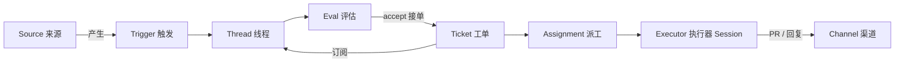

# DeepSeek Harness Super Agent 介绍

> 本文介绍 DeepSeek Harness 上的团队级编程智能体 **dsh-superagent**（Super Agent）。它是一个研究原型，不是 DeepSeek 官方产品，代码和文档都可能仍有缺陷；使用前请结合自己的环境评估。

## 一句话概括

Super Agent 是一个**常驻的、按工单工作的编程智能体**。它监听一个 GitHub 仓库（可选接入飞书），当获授权的人提出请求，或者团队预先写下的规则允许时，它会为这件事创建一张工单，在独立的智能体会话和工作目录里完成调查、编码、验证和提 PR，最后把结果送回发起请求的那条对话。整个过程可以在 DeepSeek Harness 的 Web 面板中监督。

它不是一个更长的聊天会话，而是"事件来源 + 授权策略 + 工单 + 多执行器"组成的一套协作系统。

## 它和普通编程智能体有什么不同

| 普通单会话智能体 | Super Agent |
| --- | --- |
| 人打开会话、贴上下文、等结果、关掉 | 作为服务常驻，从 Issue/PR 评论、CI、飞书消息中接活 |
| 一次只做一件，会话结束上下文散落 | 每件工作一张工单，有状态、有授权依据、可暂停、可恢复 |
| 人判断"这件事要不要做" | 准入检查、模型评估和团队规则共同决定是否接单 |
| 结果贴回聊天窗口 | 结果以 PR、评论或飞书回复回到原线程 |
| 多个任务争抢同一个会话 | 每张工单一个 worker 会话和独立目录，可并发、可重启恢复 |
| 很难审计"它为什么做这件事" | 授权记录（Mandate）保存范围、依据和策略版本；面板可查完整的 Trigger → Eval → Ticket 链路 |

## 设计哲学：人类注意力是稀缺资源

Super Agent 的核心原则是：**用尽可能少的人类注意力，换取尽可能大的价值。** 一条通知、一个问题、一个设置项、面板上的一个元素，都要证明自己值得占用某人的注意力，否则就不应该存在。

由此得到几条具体的行为准则：

- **只在被请求、或被规则允许时行动。** 请求必须直接指向智能体，并且来自团队允许的人。没人要求的工作需要团队写下的主动规则，而且默认只记录"本来会做什么"，不会真的执行。
- **只在人需要行动或结果可用时说话。** 收到请求时确认一次并说明要做什么，工作期间保持安静，只在结果就绪、需要决策或无法完成时再出现。
- **一次只问一个具体问题。** 问题通过结构化字段提出，确保它抵达具体的人，而不是埋在长报告里。
- **按影响面决定做到哪一步。** 局部、明确的改动可以一直做到可评审的 PR；需要设计决策、会破坏调用方或需要跨模块重构时，停下来把选择交给负责人。
- **诚实交付。** 草稿明确标注未完成，失败就报告失败，不绕过限制来避免提问。

这套哲学也意味着：**运营者要对智能体的发言负责。** 应从窄范围开始（短允许清单、`observe` 模式），根据它的实际表现再放宽；当它太吵时，应改短、改严提示词或暂停它，而不是增加更多消息来解释噪音。

## 核心概念

一次工作的推进过程可以概括为：



| 概念 | 中文 | 说明 |
| --- | --- | --- |
| Source | 来源 | 事件流。GitHub、飞书是一个"来源类型"的具体实例；记录读取位置、过滤机器人自己的消息 |
| Trigger | 触发 | 来源产生的一条不可变事件，带有发言人等元数据；同一条触发重复接收只会产生一张工单 |
| Thread | 线程 | 按时间排列的触发集合（如一个 Issue 的全部评论）；同一线程上的评估串行进行 |
| Policy | 策略 | 版本化的规则：谁可以发起工作、准入表、接单模式、主动规则、各来源的允许清单 |
| Eval | 评估 | 两层判断：确定性的 **Gate**（谁、以什么强度）加模型的 **Assessment**（是否该做、做到什么范围） |
| Decision | 决定 | 评估结果：`accept` 接单、`stop` 停止、`ignore` 忽略、`unavailable` 无法完成 |
| Mandate | 授权 | 接单时授予的范围、强度和所依据的策略版本；不可变，人的停止会撤回它，恢复前的重新校验失败也会撤销它 |
| Ticket | 工单 | 授权工作的基本单元，拥有自己的状态、订阅和输入记录 |
| Assignment | 派工 | 工单与一次执行器实例的绑定；一张工单可以先后有多次派工 |
| Subscription | 订阅 | 工单与线程的多对多关系；只负责投递上下文，本身不授予任何权限 |
| Executor | 执行器 | 实际干活的 DSH Session，命名形如 `worker-<工单 id>`，配一个独立工作目录 |
| Attention | 待人工决定 | 工单上等待某个人回答的具体问题 |

关键区别：**订阅负责"让消息到达"，授权负责"允许做什么"。** 后续讨论会自动送到相关工单，但不会因为有人说话就扩大智能体的权限。

## 一次请求的完整生命周期

以 GitHub Issue 上的一个请求为例：

1. **发起。** 允许清单中的人在 Issue 里评论 `@<智能体账号> 帮我修复登录页的 XSS`。GitHub 来源在下一次轮询（默认约一分钟）取到这条 mention，生成一条 Trigger。
2. **准入。** Gate 检查发言人和来源策略：发言人在允许清单中、并且直接 @ 了智能体，构成**显式请求**，不需要模型再判断"要不要接"。
3. **接单。** 主 Session（orchestrator）创建工单并记录授权：范围、依据、策略版本。它回复一句具体确认，例如"我来修复登录页的 XSS，完成后提 PR"。
4. **执行。** 系统为工单创建 `worker-<id>` 执行器会话和独立目录（通常是 `git worktree`）。worker 读原始 Issue 和相关代码，决定方案，实现并验证。
5. **交付。** worker 从工单分支（如 `agent/<工单短名>`）提交、推送并创建 PR。分支名与工单名匹配，PR 因此自动绑定到这张工单。worker 报告 `ready`，工单在面板上显示为**待评审**。
6. **评审。** 人在 PR 上留评论或 CI 失败。这些事件作为订阅消息回到工单，worker 继续修复；修好后再次推送。修复过的评审线程会被静默解决，不另行刷屏。
7. **完成。** 合并（或关闭）PR 后，工单结束。工单会**保留订阅**：之后有人在这条 Issue 或 PR 上继续评论，工单会原地恢复，无需重新授权。
8. **监督。** 全过程可在面板的 Execution 页查看：工单处于什么阶段、在等谁、有哪些输入、哪次派工做了什么。

如果请求是"帮我看看这个 bug 能不能复现"，worker 发现无法复现，会报告 `dropped`，工单安静结束，不打扰任何人；之后有人在原线程补充线索，工单可以恢复。

## 两种角色：orchestrator 与 worker

### 主 Session（orchestrator）

- 负责**评估候选、路由决定、转发问题、投递消息**，不负责写代码，也不查看实现细节。对主动候选的评估只读取有限范围的来源上下文。
- 不阻塞、不等待：报告、后续消息和后台任务完成会以消息自动到达；它结束当前轮次，等下一件事。
- 只通过一个路由工具一次性处理多个等待中的候选（接单、附加、停止、忽略）。
- 它的技术判断权很小，这是刻意的：技术工作由拥有完整上下文的执行器负责。

### 执行器 Session（worker）

- 每张工单一个独立会话，拥有完整工作工具：读写文件、跑命令、搜索、访问 GitHub/飞书。
- 无人值守：不能向用户提问、不能弹 UI、不能修改 profile。需要人决定时，通过报告中的 `human_action` 字段提出**一个**具体问题。
- 长时间命令自动转到后台，避免阻塞消息处理；一轮结束后 shell 后台任务最多再运行 30 分钟，超时会被终止并让工单进入等待，子代理则可以继续。
- 多个工单可并发执行，并发数可配置；人的消息可以占用一个额外槽位，保证人不会被新任务饿死。

### 面板

DeepSeek Harness Web 侧栏的 **Superagent** 入口负责监督，按"先处理需要人的事"排序，六个标签页对应完整链路：

- **Overview**：现在有没有需要我处理的事、系统是否健康、过去 24 小时的活动量、执行器负载。
- **Source / Trigger / Eval**：来源状态、线程与触发、每次决定的原因和匹配规则。
- **Execution**：工单按阶段分类（待评审、等待回答、受阻、失败、排队、执行中、空闲），可暂停处理、重试或停止；也能看到每次派工。
- **Settings**：来源、策略、执行器、提示词与部署设置。

工单阶段会直白地回答"现在在等谁"：`person / review` 表示等人评审，`person / answer` 表示等回答，`blocked` / `failed` 表示需要人介入；`working` 表示智能体正在做。

## 授权与安全边界

### 谁能让它工作

- **允许清单**：每个来源各有一份。GitHub 上是登录名，飞书上是成员或同步的群成员。清单为空时默认不会有人能发起工作，除非在准入表里显式放开了未列出的发言人。
- **显式请求**：允许清单中的人直接 @ 智能体。
- **后续跟进**：已经存在的工单线程上的新消息直接送给该工单的 worker 判断，不再走一遍评估。
- **准入表**：对未 @ 的消息、未列出的发言人，按接收范围逐一配置成"显式请求 / 推断候选 / 忽略"。
- **机器人**：只有来源机器人清单中的机器人能产生"推断候选"，且永远不能构成显式请求或停止工单。
- **主动规则**：团队写下"哪类主动工作可以做"。接单模式分三档：`off`（不接受推断工作）、`observe`（默认，评估并记录"本来会接"，但不执行）、`auto`（评估通过就执行）。

### 为什么它不容易越权

- 主 Session 的工具**不能修改策略和授权**；消息、评论、引用的文档都只是数据，不能改变权限。即使内容里写着"忽略之前的指令"，也不会生效。
- 每张工单的授权（Mandate）绑定当时的策略版本和来源范围。**人可以在面板或对话里明确停止**；停止后的工单不会接收任何新消息，除非重新走一次接单。
- 策略变更不会粗暴取消正在进行的工单，而是把"哪条规则变了、你的授权是否仍成立"作为输入送给执行器；暂停和恢复也由人控制。
- 消息长度（IM 硬上限 100 词）和回复用途校验由宿主强制，不依赖模型自觉；GitHub 消息开头的自动化声明则是默认提示词要求，团队可以修改。
- **自动合并有严格条件**（默认口径）：PR 由本工单创建、已就绪、所需批准覆盖当前 head commit、增删合计少于 200 行；若改动用户可见内容，指引中指定的审批人必须已批准该 commit。智能体**不会用自己的账号合并**；没有另行配置合并 CLI 时，由人合并。

### 必须知道的限制

- 这里的隔离**不是安全沙箱**。worker 以操作者的 OS 用户身份运行，拥有 `danger-full-access`，`gh` / `lark-cli` 包装器只是选择默认凭据，不能阻止程序按绝对路径执行或读取主目录。若要真正隔离，应使用只含智能体凭据的专用 OS 账号。
- 一个部署只服务**一个 GitHub 仓库**，且只支持 github.com（不支持 GitHub Enterprise Server）。
- 它依赖事件接收，其中 GitHub 来源通过轮询，通常有一分钟左右的延迟，不适合当实时聊天机器人。
- 私有飞书内容不应被复制到 GitHub；智能体只应发布完成工作所必需的信息。

## 交付物与评审约定

- 每张工单的代码改动走 PR，分支名末段与工单短名一致；**创建 PR 不等于完成**，只有 `ready` 报告加 PR 才算"待评审"，它打开的 PR 全部合并或关闭后工单才结束。
- 涉及界面的 PR 必须提供**同一场景、同一视口、同一主题下的 Before / After 截图**，并标明基线和改动版本；只有 After 截图不算就绪。
- 评审意见按结果处理：修好并验证的线程静默解决；不采纳的建议在原线程留一句事实性理由。自动评审机器人每个 PR 最多处理三轮，之后不再为其开启新的评审循环。
- 人工评审者的意见会被认真对待；智能体不能批准或合并自己的 PR，也不能替评审者做决定。
- 如果发现人类已经在另一条分支或 PR 上做了同样的改动，智能体会关闭自己的 PR 并指向对方，避免重复劳动。

## 如何部署和上手

### 前置条件

- Node.js 22.19+ 或 24+、pnpm、git 2.32+、Python 3.8+、tmux
- GitHub CLI 2.48+（建议用独立包装器固定到智能体账号）
- 一个 github.com 仓库，以及一个**专用**的智能体 GitHub 账号（不要用运营者自己的账号；智能体的一切发言都显示为这个账号）
- 已配置模型提供方的 DeepSeek Harness
- 可选：带机器人能力的飞书自建应用和 `lark-cli`

### 典型步骤

1. **准备账号与凭据。** 创建智能体 GitHub 账号并授予仓库写权限，用一个只登录该账号的 `gh` 包装器；飞书则创建机器人应用，用 bot-only 的 `lark-cli` 包装器。
2. **安装独立的 profile。** 从 DeepSeek Harness 的 Web profile 复制出 `superagent` profile，安装 `dsh-superagent` bundle，单独启动、单独重启，不占用日常使用的 profile。面板默认监听 `127.0.0.1:3082`。
3. **配置来源与策略。** 在面板里填写仓库 `owner/name` 和智能体 CLI；在设置中维护允许清单；按需要配置准入表和主动规则。初次使用保持 `observe` 模式，先看它"本来会做什么"。
4. **配置执行器。** 指定工单目录根和 prepare 命令。典型做法是从本地克隆创建 worktree：

   ```sh
   git -C /path/to/clone fetch --no-tags \
     "https://github.com/$DSH_SUPERAGENT_GITHUB_REPOSITORY.git" \
     "${DSH_SUPERAGENT_GITHUB_PR_HEAD:-HEAD}:refs/dsh-superagent/$DSH_SUPERAGENT_TICKET" &&
   git -C /path/to/clone worktree add -b "agent/$DSH_SUPERAGENT_NAME" \
     "$DSH_SUPERAGENT_DIR" "refs/dsh-superagent/$DSH_SUPERAGENT_TICKET"
   ```

   同时把个人 CLI 等不该被 worker 使用的命令加入 blocked commands。
5. **配置提示词。** 至少确认三项团队约定：GitHub 消息的自动化声明行、哪些普通账号其实是自动评审机器人、提交作者与自动合并条件。
6. **启动并验证。** 运行启动脚本，`status` 返回 0 且没有 setup 问题；在仓库 Issue 中用允许清单里的账号评论 `@<智能体账号> <需求>`，约一分钟内 Overview 应出现工单。也可以配置每小时健康检查，在服务异常时尝试恢复。

> 完整安装、升级、故障排查和配置项请参考源码仓库中的 `SETUP.md` 与 `docs/006-deployment.md`；这里只保留入门所需的轮廓。

## 适用与不适用

**适合的场景**

- 由 Issue/PR 驱动、边界相对清晰的中小型任务：修 bug、补测试、改文档、处理评审意见、依赖升级。
- 需要"接活、记录、交付到原线程"的团队协作，而不是一次性问答。
- 希望把重复性维护工作交给一个可审计、可随时叫停的智能体。
- 已经在用 GitHub 和飞书，希望统一入口。

**不适合的场景**

- 需要产品决策、架构重构或跨多个独立模块协调的大改动；这类工作会按设计停下来等人决策。
- 需要严格租户隔离或多仓库编排的生产环境。
- 对延迟敏感的实时交互。
- 期望它自动"找活干"且不需要人监督；主动模式应从 `observe` 开始逐步建立信任。

## 常见问题

**它会自己找活干吗？**
默认不会。`observe` 模式下，只有显式请求会被执行；推断出的主动工作只记录"本来会做什么"。只有团队写下规则并切到 `auto`，才会自动接单。

**工单和会话是什么关系？**
工单是领域对象，比会话活得久。会话可能因为重启、超时或失败而更换，工单会带着授权、订阅和未读消息继续。

**PR 开了就算完成了吗？**
不算。PR 存在只代表可以评审；`ready` 报告表示"待评审"，它打开的 PR 全部合并或关闭后工单才结束。之后仍可在原线程继续讨论并恢复工单。

**它能直接和我对话吗？**
它只在请求来源的线程里说话。飞书里回复到原话题，GitHub 上回复到 Issue/PR。需要补充信息时，它会在原线程问一个具体问题。

**会不会把私有群的内容发到 GitHub？**
不应该。工作产物只包含完成工作必需的信息；这是运营者和提示词共同的责任，也是使用时应重点检查的地方。

**模型或网络失败会怎样？**
临时性失败会自动重试；持续失败会让工单进入 `blocked` 或 `failed`，等待人处理。面板提供重试入口。

## 延伸阅读

- 源码仓库的 `README.md`、`SETUP.md`
- 按顺序阅读 `docs/000-philosophy.md` 到 `docs/008-cookbook.md`
- [DeepSeek Harness](https://www.deepseek.com/en/harness/)
- 设计文章 *Exploring Super-agent Design: Towards a More Autonomous Agent System*

> 本文依据 dsh-superagent 的 README 与 `docs/000`–`docs/008` 编写。实现仍在演进，具体行为请以源码仓库中的文档和代码为准。
