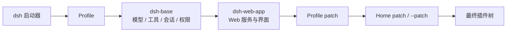

# DeepSeek Harness 介绍

> 本文介绍 DeepSeek AI 开源的智能体运行框架 **DeepSeek Harness**（简称 DSH，命令行 `dsh`）。它把大模型、工具、工作区、会话和权限策略组装成一个能真正“干活”的智能体，并以“一切皆插件”的方式允许替换和扩展其中的几乎每个部分。
>
> DSH 目前处于**开发者预览**阶段，仍在快速迭代，可能出现破坏兼容性的变更。本文依据 2026 年 11 月的官方文档、产品页面和开源仓库整理；具体行为以官方文档和实际版本为准。

## 30 秒了解

- **是什么**：DeepSeek 开源的 agent harness（智能体运行框架），MIT 许可。它不是模型，也不是单纯的聊天客户端。
- **最大特点**：一切皆插件。模型适配器、工具、会话存储、Agent 循环、Web 界面都是插件，通过 profile 按需组装。
- **能做什么**：在本地工作区读写文件、执行命令、检索资料、生成文档、表格和演示文稿、修改代码仓库、运行测试、执行后台与定时任务，并可用子智能体拆分复杂工作。
- **怎么用**：桌面端开箱即用；或 `npx @deepseek-ai/dsh web` 启动 Web UI；也可用 headless、SDK 或 ACP 嵌入自动化流程。
- **前提**：需要自备模型凭据（DeepSeek API Key、DeepSeek 账号，或兼容的第三方/自定义端点）。
- **注意**：仍是预览版；不是安全沙箱；第三方插件和索引等同代码，需要信任与审查。

## 1. 它是什么

### 1.1 模型与 harness

大模型负责理解与推理，但“把事情做完”还需要另一层能力：读取项目文件、调用工具、执行命令、保存进度、在关键操作前请求批准、把结果呈现给人。这一层通常被称为 **agent harness**。

可以把它类比为：模型是大脑，harness 是手脚、工具带、工作台和操作规程。同一个模型放进不同的 harness，能完成的任务、可靠性和安全边界会完全不同。

DSH 就是 DeepSeek 对这一层的开源实现。它不训练模型，也不绑定某一个模型；它解决的是“如何让模型在一个真实工作区里持续、可控地完成任务”。

### 1.2 DSH 的定位

- **本地优先**：进程运行在你的电脑上，直接操作你选择的工作区；会话内容按需发送给你配置的模型提供方和你启用的工具服务。
- **多入口**：同一套核心能力可以以桌面应用、Web UI、命令行、SDK/ACP 的形式使用。
- **可组装**：产品不是一份固定功能列表，而是由插件组合出来的 profile；换模型、换工具、换界面、换存储都可以通过配置或插件完成。
- **开放**：MIT 许可，源码、文档和插件生态公开；社区插件通过 `dsh-plugin` 话题聚合。
- **仍在早期**：开发者预览，不承诺生产可用性与兼容性。

### 1.3 与 dsh-superagent 的区别

DSH 是通用运行时；**dsh-superagent** 是构建在 DSH 之上、面向“一个 GitHub 仓库 + 可选飞书”的团队级常驻智能体 bundle，用来源、触发、工单、执行器和面板来组织工作。前者回答“智能体怎么跑起来”，后者回答“团队如何把活交给智能体并跟踪”。

本仓库另有一篇[《DeepSeek Harness Super Agent 介绍》](deepseek-harness-super-agent.md)详细说明后者。

## 2. 为什么值得关注

**从“给建议”到“交结果”。** 普通聊天只能把代码或步骤贴给你；DSH 直接在工作区里读写文件、运行命令、执行测试，并把改好的文件、表格或代码改动作为结果交付。模型可以自己验证，而不是让你复制粘贴后再回来描述错误。

**从“绑定一个模型”到“自由组合”。** DSH 把模型、工具、界面和存储都放在可替换的接缝上。你可以今天用 DeepSeek，明天换成 Anthropic 或公司内网网关；也可以只替换 Shell 提供方，让同一套工具跑在本地或远程沙箱里。

**从“一次性会话”到“可持续工作”。** 会话有持久日志，可以恢复、分支和压缩；长命令可以转入后台；任务可以定时执行；复杂工作可以拆给子智能体。即使进程重启，工作也不会全部丢失。

**从“黑盒”到“可观察、可控制”。** 每次模型请求、工具调用、参数、结果和耗时都能在开发者工具里查看；权限按会话选择，敏感操作逐次审批；配置是可审查的文本，插件代码也可以检查。

## 3. 核心设计：一切皆插件

### 3.1 Cordis：插件、服务与可逆副作用

DSH 构建在 [Cordis](https://github.com/cordiverse/cordis) 之上。Cordis 的核心模型很简单：

- 插件向共享上下文贡献能力；
- 能力以带 key 的服务暴露（如 `ctx.tools`、`ctx.llm`、`ctx.sessions`）；
- 插件通过 `inject` 声明依赖，依赖就绪后再启动；
- 插件之间用类型化事件通信；
- 注册是可逆的副作用，插件卸载时自动撤销。

DSH 把这条原则推到极致：模型适配器、工具注册表、会话日志、Agent 循环、Web 服务器、浏览器界面……都是插件。没有需要打补丁的“特权内核”，扩展方式是在旁边挂一个插件。

### 3.2 Profile、Bundle 与 Patch：产品是叠出来的

一次运行中的 `dsh` 是一棵插件树，由按顺序叠加的配置层组合而成：

- **Profile**：具名组装，位于 `$DSH_HOME/profiles/<name>`，例如 `web`、`headless`、`sdk`、`sdk-minimal`、`acp`、`desktop`。
- **Bundle**：可分发的一套 Cordis 配置与挂载代码，例如 `dsh-base`（模型、工具、持久化、权限等基础层）、`dsh-web-app`（Web 界面）、`dsh-headless`（一次性运行）。
- **Patch**：按插件 id 覆盖配置或插入新插件。

叠加顺序是：各 bundle → profile 的 `cordis.patch.yml` → home 级 patch → `--patch`。命令 `dsh --profile web --dump-config` 可以打印最终组合出的插件树；树里的任何一项都可以被上层 patch 替换。



### 3.3 能力 seam：定义、提供方、消费方

对于一项可替换的能力，DSH 把它拆成三种角色：

- **Service Definition**：定义接口和数据类型，例如 `dsh-shell`；
- **Service Provider**：实现接口，例如本地 Shell、沙箱 Shell、SSH 远程执行；
- **Consumer**：把能力暴露给模型，例如 `dsh-tool-bash`。

以 Shell 为例：模型看到的是同一个 `bash` 工具；底下可以换成沙箱执行器或远程执行器，工具定义和提示词不需要改。文件系统、Web 访问、LLM、存储、终端、子智能体等能力都采用类似结构。

### 3.4 这对使用者和开发者意味着什么

- 你可以只用 DeepSeek 模型，也可以接 Anthropic、OpenAI、Kimi、GLM 或自建网关。
- 你可以只装 Web 界面，也可以把 DSH 作为 headless/SDK 嵌进 CI 或内部系统。
- 你可以为内部系统写一个插件，把 API 变成模型可调用的工具；也可以用“创造模式”让 Agent 帮你写。
- 团队可以把常用流程写成 skill 或自定义预设，随插件分发给成员。
- 出问题时可以沿插件树定位：是模型、工具、权限策略，还是某个插件的行为。

## 4. 主要能力

### 4.1 多种入口，一套核心

| 入口 | 启动方式 | 适合 |
| --- | --- | --- |
| 桌面端 | 官网下载安装（macOS Apple 芯片 / Windows 64 位） | 开箱即用，本地工作区与终端 |
| Web UI | `npx @deepseek-ai/dsh web`，默认 `http://127.0.0.1:3080` | 浏览器访问，开发与远程使用 |
| Headless CLI | `dsh --profile headless "任务"` | 脚本、CI、一次性任务 |
| SDK / ACP | `dsh --profile sdk`、Python SDK、ACP | 嵌入自有应用或自动化客户端 |

桌面端是同一套 Web 应用外面的一层 Electron 壳，内置运行时，并保留自己独立的 `desktop` profile。Web UI 默认只监听本机；对外提供服务需要反向代理、TLS 和受信主机配置。

### 4.2 模型接入

DSH 不要求使用某一个模型：

- **DeepSeek**：API Key，或登录 DeepSeek 账号；
- **内置第三方**：Anthropic、OpenAI、Kimi（`moonshotai`）、GLM（`zai`）等；
- **自定义端点**：任何兼容 OpenAI Chat Completions、OpenAI Responses 或 Anthropic Messages 协议的服务，包括公司网关、中转站和自建服务；
- **模型能力**：上下文窗口、最大输出、图片输入、推理等级等可按模型配置；
- **凭据**：保存在 `$DSH_HOME/.credentials.yaml`，设置界面只写入、不回显明文；环境变量也可作为后备。

模型切换在下次请求时生效；已经发送过请求的会话会保留日志中记录的模型。模型选择器还可以设置推理等级（off / low / medium / high 等）。

> 会话内容会发送给你选择的模型提供方。使用第三方或自建端点前，先确认其数据处理方式。

### 4.3 工作区与执行

- **工作区**：会话绑定一个本地目录。Web 首次使用时需要添加并选择工作区；CLI 以启动目录作为默认工作区。Agent 只能通过工具访问被允许的路径。
- **文件**：读取、写入、精确编辑，以及按内容或文件名搜索。
- **命令**：Bash（Windows 上是 PowerShell），支持后台任务、持久终端、超时与输出上限；长命令可以转入后台，同时继续对话。
- **Web**：搜索和抓取网页（需要配置搜索 provider 或凭据）。
- **成果**：生成的 Word、Excel、HTML、PDF、Markdown 等文件可以在会话中直接预览、打开或下载。
- **验证**：Agent 可以运行测试、构建和 lint，并把结果作为下一步的依据。

### 4.4 会话、持久化与长任务

- 每个会话是一份**只追加的事件日志**；模型看到的内容都可以从日志重建。
- 支持**恢复**、**分支（fork）** 和自动**上下文压缩**；进程崩溃后也能从日志恢复。
- 长任务可以放进**后台 Job**，随时查看进度或停止。
- **目标（Goal）** 可以把一个完成目标附着在会话上，跨多轮持续推进；**计划模式（Plan）** 让 Agent 先给出计划，经人确认后再执行。
- 多个会话可以并行，各自拥有独立的上下文和工作目录。

### 4.5 多智能体

- **子智能体（Subagent）**：把一段独立工作委派给子会话，拥有自己的上下文与工具，完成后把结果交回；支持并行、命名、继续、中断和收件箱等待。
- **Agent Teams（实验）**：多个子智能体共享一块任务板（任务 DAG），可以分工、认领、互相发消息。
- **适用场景**：大范围调研、多个独立模块的修改、并行验证。强耦合或需要频繁对齐的工作，拆碎反而会增加成本。

### 4.6 自动化

- **定时任务**：Web 侧栏的“自动化任务”可以按一次、每 N 分钟/小时、每天、每周、每月或自定义规则运行，把指令投递到现有会话或新会话；也可以让模型用 `schedule_*` 工具创建提醒。
- **Headless**：一条命令读完任务、输出最终答案并退出，适合 CI 和脚本。
- **SDK / ACP**：把 DSH 作为服务嵌入其他程序或自动化客户端。
- **Webhook**：可选的 GitHub 评审 overlay 在 PR 进入 `ready_for_review` 时创建只读评审会话（实验性，需要自行配置密钥、反向代理和仓库规则）。

### 4.7 插件、技能与 MCP

**插件**

- 插件可以是 npm 包或 Git 仓库，声明 `dsh.bundle` 后即可作为组合包安装。
- 安装方式：Web 的插件页，或 `dsh plugin --profile web add <包名>`。
- **插件索引（实验）**：DSH 不内置索引源；添加可信的索引 URL 后，可以浏览、查看版本兼容性并安装。索引和插件都是第三方内容，需要自行核验。
- **创造模式（Creator）**：在对话中描述想要的插件，Agent 会加载插件开发技能、检查运行时 API、生成代码、安装并验证。官网的示例是“做一个番茄时钟悬浮插件”。这让“为内部系统写一个小工具”不再需要完整的插件开发流程。

**技能（Skill）**

- 一个目录或 Markdown 文件，带 frontmatter（`name`、`description`），正文是给 Agent 的操作说明。
- 发现位置包括项目 `.dsh/skills`、`.agents/skills`、`~/.dsh/skills`、`~/.agents/skills` 等；编辑后无需重启。
- 适合把团队规范、排查步骤、发布流程固化下来，让 Agent 按需加载，而不是把所有内容都塞进系统提示词。

**MCP**

- 支持连接 MCP（Model Context Protocol）服务器，把外部工具、资源和指令接入会话。
- 官方文档给了“记忆服务器”等示例；企业也可以把内部系统包成 MCP 服务。

**Agent 预设与界面扩展**

- 内置标准、极简、创造等预设；不同预设决定工具集、提示词和行为边界。
- 可以复制预设、修改其插件清单，做成团队自己的“工作模式”。
- 客户端 UI 也由插件组成，可以增加设置页、侧栏面板、工具卡片或渲染器。

### 4.8 可观察与可配置

- **开发者工具**：按轮次和步骤查看模型请求、工具调用、参数、结果、schema 和耗时。
- **会话日志**：所有模型可见输入都有记录，便于回放、审计和恢复。
- **配置即代码**：profile、patch、预设都是 YAML/JSON，可版本化、可审查；`--dump-config` 查看最终组合。
- **热重载**：启用 HMR 时，修改 profile 或 patch 后会自动重组插件树，不必重启。
- **用量与遥测**：有 token 计量；可以选择接入 OpenTelemetry。

## 5. 架构速览

### 5.1 组成

一个 DSH 进程大致分为三层：

- **Host（Node 进程）**：插件树、Agent 循环、工具执行、会话持久化、模型请求、权限与沙箱。
- **Client（浏览器或桌面渲染层）**：会话界面、工作区、插件页、设置、开发者工具；通过 HTTP/WebSocket 与 Host 通信。
- **Profile 层**：决定这次启动挂载哪些 bundle 和 patch。

主要服务包括：

| 服务 | 作用 |
| --- | --- |
| 会话 | 只追加的事件日志、查询与投影 |
| 提示词组装 | 系统提示词、上下文和工具 schema 的组装 |
| 工具注册表 | 按作用域注册工具，并执行带把关的流水线 |
| Agent 注册表与循环 | 管理活跃 Agent，驱动默认的模型-工具循环 |
| LLM seam | 消息/流式协议和模型适配器 |
| 审批与沙箱 | 会话级权限策略、逐次审批和文件/命令限制 |
| 技能、MCP、后台任务 | 按需加载的指令、外部工具连接和异步执行 |

### 5.2 一次任务如何运行

```text
用户消息
  → 组装系统提示词、上下文和工具 schema
  → 调用模型
  → 模型返回工具调用
  → 权限检查 / 人工审批
  → 执行工具，把结果写回会话
  → 进入下一个 step（或结束当前 turn）
```

一个 **step** 是一次模型请求加上它触发的工具执行；一个 **turn** 可以包含零个或多个 step，在不再有欠下的工作时关闭。轮次、步骤、消息和工具结果都会写入会话日志。

### 5.3 数据与扩展点

- **会话日志是事实来源**：恢复、fork、界面投影、遥测都从日志派生。
- **三个事件域**：持久会话事件、Agent 实时事件、能力事件（如 `fs/*`、`tools/*`）。
- **新行为优先做成插件**：注册工具、提示词段、服务提供方或监听器，而不是修改核心循环。
- **能力通过 seam 替换**：文件系统、Shell、Web、LLM、存储、终端、子智能体都可以换实现。

## 6. 快速上手

### 6.1 桌面端

1. 从[官网](https://www.deepseek.com/harness/)下载对应安装包（macOS Apple 芯片 / Windows 64 位）。
2. 打开应用，登录 DeepSeek 账号，或在“设置 → 模型”中配置 API Key。
3. 选择工作区（本地项目目录）。
4. 新建会话，描述任务。
5. 需要时在插件页安装插件，或在创造模式中让 Agent 写插件。

### 6.2 Web UI

```sh
npx @deepseek-ai/dsh web
```

- 默认打开 `http://127.0.0.1:3080`；`--no-open` 只启动不打开浏览器，`--port` 可以改端口。
- 首次使用：设置 → 模型，填 DeepSeek API Key；添加并选择工作区；新建会话。
- 远程或对外使用：默认只监听 loopback；需要反向代理、TLS 和 `--trusted-host` / `--public-url`，并自行添加访问控制。

### 6.3 其他入口

```sh
# 一次性任务：新会话执行，打印最终答案后退出
dsh --profile headless "运行测试并总结失败原因"

# 安装插件到 web profile（把 <插件包名> 换成实际包名）
dsh plugin --profile web add <插件包名>

# 以 SDK 服务启动（JSON-RPC over stdio）
dsh --profile sdk
```

### 6.4 第一次可以试什么

| 场景 | 提示词示例 |
| --- | --- |
| 办公文档 | “读取 sales.xlsx，按月份汇总销售额和同比/环比，输出新的 xlsx，并说明计算口径。” |
| 代码仓库 | “阅读这个仓库，找到 `pnpm test` 失败的原因，修复并重新运行相关测试。” |
| 资料调研 | “调研这个方向最近一年的进展，给出带来源链接的结论，区分事实与推测。” |
| 定时任务 | “每周五 17:00 汇总本周 git 提交，生成周报。” |
| 插件开发 | “帮我做一个番茄时钟悬浮插件，安装好并验证它能运行。” |

### 6.5 配置模型与权限

- **DeepSeek**：设置 → 模型 → 填入 API Key。密钥是只写的，保存后界面只显示脱敏信息。
- **第三方或自定义端点**：添加模型提供商，选择 OpenAI Chat Completions、OpenAI Responses 或 Anthropic Messages 协议，填写基础 URL、凭据和模型。
- **权限预设**：默认是 `workspace-write` + `ask`（限制在工作区写文件，关键操作询问）；`danger-full-access` + `never` 适合完全信任的任务；实验性的“自动审查”默认关闭。
- **审批**：涉及文件写入、命令执行等敏感动作时，Web UI 会先请求你批准。

## 7. 安全、隐私与边界

- **预览软件**：DSH 尚未经过安全审计，不应被视为安全或生产就绪。它可能执行模型生成的代码和命令，加载第三方插件，访问网络、进程、凭据和文件。
- **沙箱不是万能**：审批、沙箱和权限控制可以降低风险，但不保证隔离，也不能保护它被允许访问的资源。
- **最小权限**：从 `workspace-write` 开始；只在信任的任务和目录使用完全访问；高风险操作逐次审批；必要时使用一次性虚拟机、容器或专用账号。
- **先备份**：Agent 能改的文件应纳入版本控制或提前备份。
- **审查第三方内容**：插件、插件索引、MCP 服务器和 skill 都可能影响行为或执行代码；安装前确认来源并阅读代码。
- **数据边界**：会话内容会发送给你选择的模型提供方；插件也可能按自身逻辑访问网络。不要把不该外发的密钥或数据放进工作区。
- **对外发布**：Web UI 默认只监听 loopback，使用启动 token 和会话 cookie 认证；反向代理需要保留 `Host`、转发 WebSocket、配置 TLS 和受信主机。不要把监听端口直接暴露到公网。
- **自动审查（实验）**：它用当前模型在工具调用前审查动作，可能误放行、误拒绝并消耗额外 token，默认关闭，不能替代人工判断。

## 8. 适用场景

**适合**

- 个人或小团队的本地自动化：整理资料、处理表格、生成文档和汇报、批量处理文件。
- 代码仓库维护：理解项目、修 bug、补测试、改文档、处理评审意见、依赖升级。
- 资料调研与核对：搜索、抓取、交叉验证、标注来源。
- 定时或重复任务：日报周报、巡检、数据汇总。
- 内部工具与插件开发：把公司 API 包成工具，或用创造模式快速做小插件。
- 多模型实验：同一工作流切换 DeepSeek、Anthropic、OpenAI 或自建网关。

**不适合或需谨慎**

- 需要严格多租户隔离、合规审计或执行不可信代码的生产平台。
- 完全无人值守的高风险操作，例如生产发布、删除数据、资金操作。
- 把 DSH 当成安全沙箱来运行不受信任的插件或命令。
- 对延迟极敏感的实时客服或聊天场景。
- 期望零配置、零学习成本地替代现有办公软件。

## 9. 与 dsh-superagent 的关系

DSH 是通用运行时；dsh-superagent 是把 DSH 用于“团队级常驻编程智能体”的一个 bundle。它在这一层之上增加了：

- **Source**：GitHub、飞书等事件来源；
- **Trigger / Thread**：不可变的触发事件和按时间排列的线程；
- **Eval / Ticket / Assignment**：评估是否接单、工单、派工；
- **Subscription / Executor**：上下文订阅和独立执行器；
- **Panel**：监督工单状态、待人工决定和系统健康。

需要“让智能体接 Issue/PR/飞书消息并提 PR”的团队工作流，请阅读[《DeepSeek Harness Super Agent 介绍》](deepseek-harness-super-agent.md)；需要“让智能体在我电脑上干活、定制自己的 agent”，本文就是入口。

## 10. 常见问题

**Q：免费吗？**

软件本身以 MIT 许可开源，可以免费使用和修改；模型 API 由各提供方计费；第三方插件可能有自己的许可和费用。

**Q：需要什么环境？**

桌面端自带运行时；从命令行启动需要先安装 Node.js，然后运行 `npx @deepseek-ai/dsh web`。具体版本要求以官方 README 为准。

**Q：一定要用 DeepSeek 模型吗？**

不用。DSH 支持 DeepSeek、Anthropic、OpenAI、Kimi、GLM 等内置提供商，也支持兼容 OpenAI/Anthropic 协议的自定义端点。

**Q：能接本地或内网模型吗？**

可以尝试把兼容 OpenAI Chat Completions、OpenAI Responses 或 Anthropic Messages 协议的本地/内网服务配置成自定义提供商；DSH 本身不内置本地模型运行时。

**Q：数据存在哪里？**

会话日志、设置和凭据在 `$DSH_HOME`（默认 `~/.dsh`）；工作区文件仍在你选择的目录里。删除会话或更换工作区不会自动清理原目录。

**Q：它会把文件上传到哪里？**

会话内容会作为上下文发送给你配置的模型提供方；插件也可能按自身逻辑访问网络。没有统一的“上传”行为，实际范围取决于 provider、插件和工具配置。

**Q：能多人一起用吗？**

它面向单机、单用户的工作流。通过反向代理可以让他人访问 Web UI，但认证、权限和隔离需要自行设计，不应直接当成多租户服务。

**Q：和 Claude Code、Cursor 有什么区别？**

DSH 是开源、可插拔的 harness，强调“一切皆插件”、多入口和模型无关；Claude Code、Cursor 是各自的产品与工作流。选择取决于你是否需要开源可改造、接入自建模型和工具，以及团队已有的工具链。

## 11. 术语小抄

| 术语 | 含义 |
| --- | --- |
| Harness | 模型之外的运行层：工具、上下文、会话、权限、界面 |
| Agent | 在会话中驱动模型和工具、完成任务的智能体 |
| Session | 一份持久会话，包含只追加的事件日志 |
| Workspace | 会话绑定的本地工作目录 |
| Profile | 一次启动使用的插件组合，如 `web`、`headless` |
| Bundle | 可分发的组合包，向 profile 插入一组插件 |
| Patch | 按插件 id 覆盖或插入配置的 YAML 层 |
| Seam | 可替换能力的接缝：定义、提供方、消费方 |
| Tool | 模型可调用的动作，如读写文件、执行命令 |
| Skill | 按需加载的 Markdown 操作说明 |
| MCP | Model Context Protocol，连接外部工具与资源 |
| Subagent | 由主智能体委派的子会话 |
| Preset | 一套 Agent 工具、提示词和行为配置 |
| Permission preset | 沙箱模式与审批策略的组合 |

## 12. 参考

- [DeepSeek Harness 官网](https://www.deepseek.com/harness/)
- [GitHub 仓库](https://github.com/deepseek-ai/deepseek-harness)
- [官方文档](https://deepseek-harness.github.io/deepseek-harness/)
- [Cordis](https://github.com/cordiverse/cordis)
- [论文：A Programming Paradigm for Spatiotemporal Composability](https://arxiv.org/abs/2608.25512)
- [社区插件话题](https://github.com/topics/dsh-plugin)
- [安全说明](https://github.com/deepseek-ai/deepseek-harness/blob/master/SAFETY.zh.md)

> 本文依据 DeepSeek Harness 官方 README、用户指南、架构文档和产品页面整理。DSH 仍在快速演进，具体能力、配置项和默认值请以对应版本的官方文档为准。
